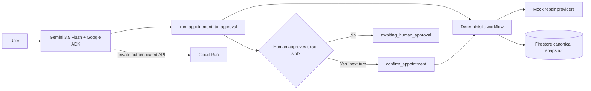

# Appointment Agent — Google ADK

Appointment Agent is an ontology-first demonstration of a trustworthy,
multi-step appointment workflow. It contacts a deterministic mock repair
provider, retries after no response, records proposed slots, stops at an
explicit human approval boundary, and confirms only the approved slot.

## Problem and value proposition

Appointment coordination looks simple, but it combines identity, communication
history, retries, provider proposals, and a consequential commitment. Agents
that collapse those concepts into chat text are difficult to audit and easy to
over-automate.

This project demonstrates a safer pattern:

- model durable domain objects independently from communication channels;
- make every workflow transition observable;
- allow autonomous retry and proposal gathering;
- require a human before committing to a time;
- persist the canonical workflow independently from the agent process.

## Ontology-first workflow

The canonical objects are `Person`, `Organization`, `ContactPoint`,
`AppointmentRequest`, `ContactAttempt`, `TimeProposal`, `Appointment`, and
`TransitionEvent`. Phone and email are contact channels, not separate request
types. See [the ontology](docs/ontology-v0.1.md) and
[architecture decisions](docs/decisions.md).

v0.2 adds a linked persistence layer: one `TrajectoryCard` is keyed by
`run_id`, append-only `EventCard` records reference that run and a `detail_id`,
and `DetailCard` records hold the corresponding editable user/provider data.
Events do not recursively embed detail data, so event history remains stable
when a detail is updated.

The demonstrated transition sequence is:

```text
requested
-> contacting
-> awaiting_reply
-> retry_due
-> contacting
-> time_proposed
-> awaiting_human_approval
-> confirmed
```

`run_appointment_to_approval` performs the deterministic work through
`awaiting_human_approval`. Only a later, explicit user choice allows
`confirm_appointment` to call the existing domain workflow and reach
`confirmed`.

## Google technology

- Gemini 3.5 Flash (`gemini-3.5-flash`) interprets user intent and selects tools.
- Google ADK 2.8.0 exposes the deterministic workflow as function tools.
- Cloud Run hosts the private ADK API service in `asia-northeast1`.
- Firestore Native mode stores one canonical workflow snapshot per `run_id`
  plus linked trajectory, event, and detail cards.
- Application Default Credentials provide runtime authentication; no key file
  is packaged with the service.

Gemini uses `GOOGLE_CLOUD_LOCATION=global`. Cloud Run and Firestore use
`asia-northeast1`; these settings are deliberately separate.

## Architecture



The Cloud Run ADK session service is currently `memory://`. Firestore is the
durable source for canonical workflow state, but ADK conversation/session
persistence across instance replacement is outside this version's scope.

## Local setup

Python 3.11 or newer is recommended.

```powershell
python -m venv .venv
.\.venv\Scripts\Activate.ps1
python -m pip install -r requirements.txt
Copy-Item .env.example .env
```

Fill in `GOOGLE_CLOUD_PROJECT` in `.env` when running Gemini or Firestore
checks. Do not commit `.env`.

Run the credentials-free deterministic demo:

```powershell
.\scripts\run_demo.ps1
```

This is the reproducible recording fallback. It uses the default JSON backend
and shows the complete state sequence without network access.

Optional checks requiring configured Google Cloud credentials:

```powershell
python .\scripts\run_adk_smoke.py
python .\scripts\run_adk_workflow_smoke.py
python .\scripts\run_firestore_workflow_smoke.py
python -m pip check
```

## Private Cloud Run deployment

The deployed service is private. It is not intended to be opened directly in a
browser, and no public UI is included.

Create or select a dedicated runtime service account with only the permissions
needed to invoke Vertex AI and read/write Firestore (for example,
`roles/aiplatform.user` and `roles/datastore.user`). Then deploy with the ADK
2.8.0 CLI:

```powershell
adk deploy cloud_run `
  --project=<PROJECT_ID> `
  --region=asia-northeast1 `
  --service_name=appointment-agent-google `
  --app_name=appointment_agent `
  --session_service_uri=memory:// `
  appointment_agent -- `
  --no-allow-unauthenticated `
  --service-account=<RUNTIME_SERVICE_ACCOUNT> `
  "--set-env-vars=GOOGLE_GENAI_USE_ENTERPRISE=TRUE,GOOGLE_CLOUD_PROJECT=<PROJECT_ID>,GOOGLE_CLOUD_LOCATION=global,MODEL_NAME=gemini-3.5-flash,APPOINTMENT_STATE_BACKEND=firestore,FIRESTORE_DATABASE=(default),FIRESTORE_WORKFLOW_COLLECTION=appointment_workflow_runs"
```

The agent folder has its own `.gcloudignore`; `.env`, bytecode, tokens, and ADC
files are not part of the source upload.

## Authenticated Cloud Run verification

Resolve the service URL and obtain an identity token at runtime. Never save the
token in source or documentation.

```powershell
$env:CLOUD_RUN_SERVICE_URL = gcloud run services describe appointment-agent-google `
  --project=<PROJECT_ID> --region=asia-northeast1 --format="value(status.url)"
$env:CLOUD_RUN_ID_TOKEN = gcloud auth print-identity-token
python .\scripts\run_cloud_run_workflow_smoke.py
Remove-Item Env:CLOUD_RUN_ID_TOKEN, Env:CLOUD_RUN_SERVICE_URL
```

The smoke script creates a unique session, verifies both tool calls and the
human boundary, then reads the same `run_id` from Firestore and checks the full
confirmed transition flow. It also verifies the trajectory, semantic events,
reverse user lookup, and ID links to detail cards.

## Mock disclosure

Provider contact is intentionally simulated by `MockRepairProviderService` and
the single packaged AC-repair scenario. No phone call, email, booking system, or
real provider is contacted. Gemini and Google Cloud services are real in the
live checks; the provider interaction is not.

## Limitations

- One deterministic mock repair scenario; no real provider integration.
- No public UI and no unauthenticated Cloud Run access.
- Human approval is slot selection only; broader policy objects are out of scope.
- ADK sessions are in memory even though canonical workflow state is durable.
- No long-term memory, Firestore query UI, notification channel, or completion
  workflow after confirmation.
- Local access to the private service depends on the host network/security
  software permitting authenticated TLS; this is not handled in application code.

## Repository map

```text
appointment_agent/
  agent.py            ADK root agent and tool registration
  adk_tools.py        two-turn ADK tool boundary
  ontology.py         canonical entities and states
  workflow.py         deterministic transitions
  mock_services.py    simulated provider responses
  state_store.py      JSON and Firestore persistence
  data/               single packaged mock scenario
scripts/
  run_demo.ps1        credentials-free recording path
  run_mock.py         deterministic workflow
  run_adk_smoke.py    Gemini connection/tool smoke
  run_adk_workflow_smoke.py
  run_firestore_workflow_smoke.py
  run_cloud_run_workflow_smoke.py
docs/
  ontology-v0.1.md
  decisions.md
  devpost-submission.md
  demo-script.md
  submission-checklist.md
```
