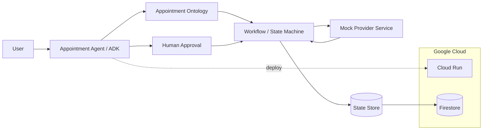

# Appointment Agent — All Things Agentic Mock v0.1.1

A deliberately small end-to-end mock for learning ontology-first agent design.

## Goal

Demonstrate one complete appointment workflow:

1. A user requests an on-site repair appointment.
2. The agent creates canonical ontology objects.
3. The agent attempts one provider contact.
4. The first attempt fails.
5. The agent retries with another provider.
6. The provider returns candidate time slots.
7. A human approval boundary is recorded.
8. The appointment becomes confirmed.
9. Every transition is logged.

The external provider service is mocked. The ontology and workflow are intended to remain stable when the mock is later replaced by email, phone, WebMCP, or another real integration.

## Hackathon target

Initial target: **All Things Agentic — Taskmaster**

Planned required stack:
- Gemini 3.5 Flash (`gemini-3.5-flash`)
- Google Agent Development Kit (ADK)
- Google Cloud Run
- Firestore in the next persistence step

## Why ontology-first?

The model separates:

- **Entity identity**: Person, Organization, AppointmentRequest, Appointment
- **Contact channel**: ContactPoint
- **Observation/event**: ContactAttempt, TimeProposal
- **Decision/action**: retry, propose, approve, confirm

An email attempt and a phone attempt are not different AppointmentRequest types. They are different observations/actions linked to the same canonical request.

## Run the deterministic mock first

No Gemini credentials are required for this first test.

```bash
python scripts/run_mock.py
```

Expected high-level flow:

```text
REQUESTED
  -> CONTACTING
  -> AWAITING_REPLY
  -> RETRY_DUE
  -> CONTACTING
  -> TIME_PROPOSED
  -> AWAITING_HUMAN_APPROVAL
  -> CONFIRMED
```

The resulting state is written to:

```text
data/mock_run_output.json
```

## ADK scaffold

Install dependencies:

```bash
python -m venv .venv
# Windows:
.venv\Scripts\activate
pip install -r requirements.txt
```

Copy `.env.example` to `.env` and fill in your Google Cloud project.

The ADK agent definition lives at:

```text
appointment_agent/agent.py
```

The model defaults to:

```text
gemini-3.5-flash
```

## Cloud Run persistence boundary

The private Cloud Run service uses `FirestoreStateStore` for the canonical
appointment workflow document. The ADK session service remains `memory://` and
is not durable across instance replacement; adding a persistent ADK session
service is intentionally outside the current scope. Local deterministic tests
continue to use `JsonStateStore` by default.

Gemini uses `GOOGLE_CLOUD_LOCATION=global`. The Cloud Run service and Firestore
database are deployed separately in `asia-northeast1`; these locations are not
interchangeable.

## Architecture



## Repository map

```text
appointment_agent/
  ontology.py       canonical entities and states
  workflow.py       deterministic state transitions
  mock_services.py  simulated external provider
  state_store.py    local persistence abstraction
  agent.py          Google ADK scaffold
  data/              packaged deterministic mock scenario
scripts/
  run_mock.py       reproducible proof-of-action demo
  run_cloud_run_workflow_smoke.py authenticated deployed API verification
docs/
  ontology-v0.1.md
  decisions.md
```

## Mock disclosure

The repair-provider contact service is intentionally simulated. It is a stand-in for a future real email / voice / WebMCP / provider API integration.
